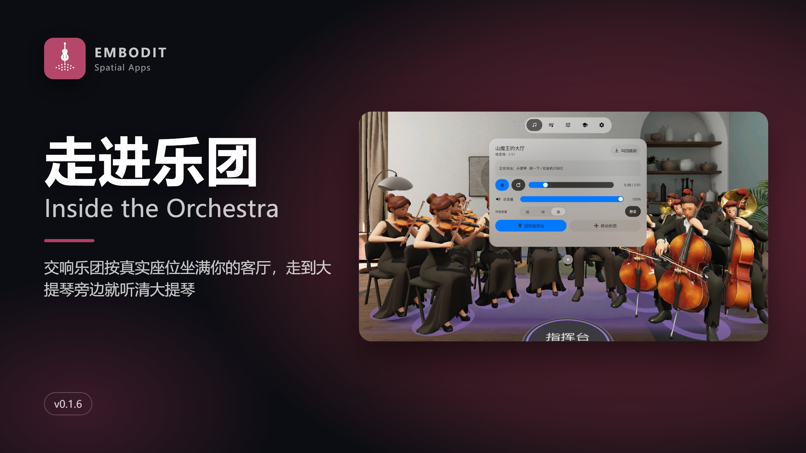
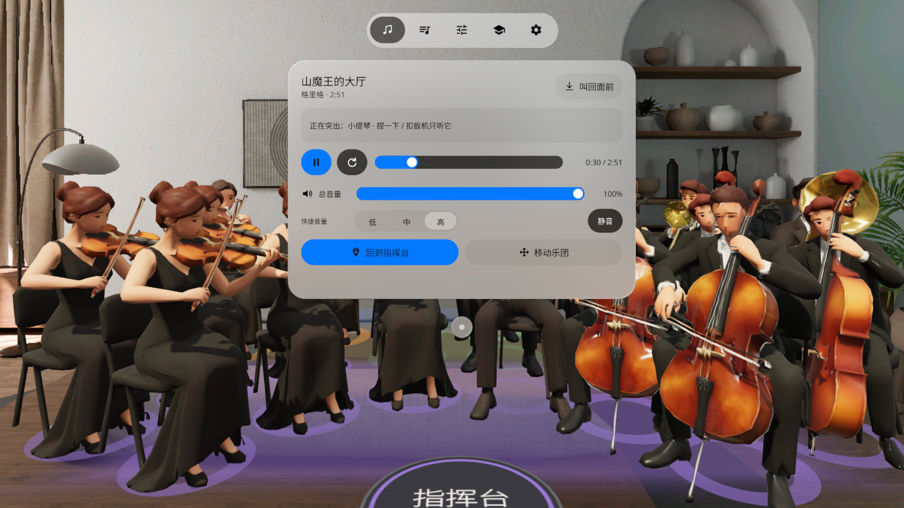
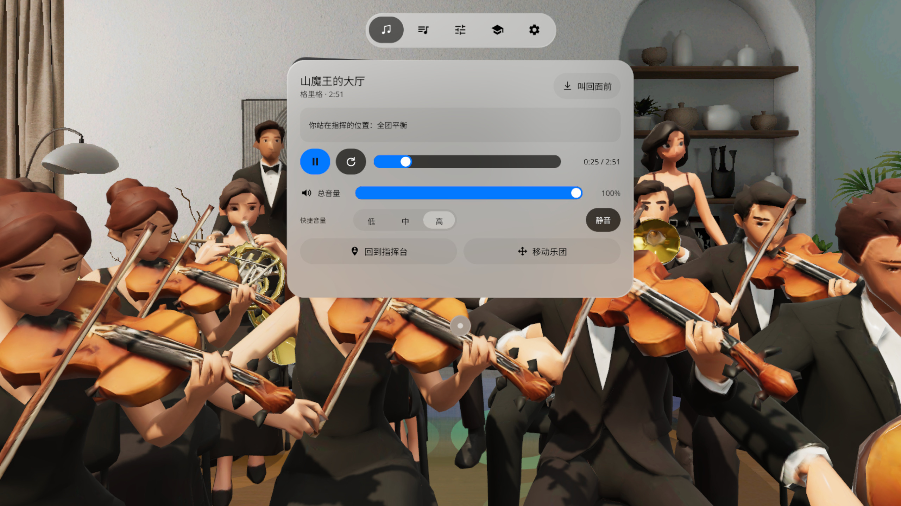
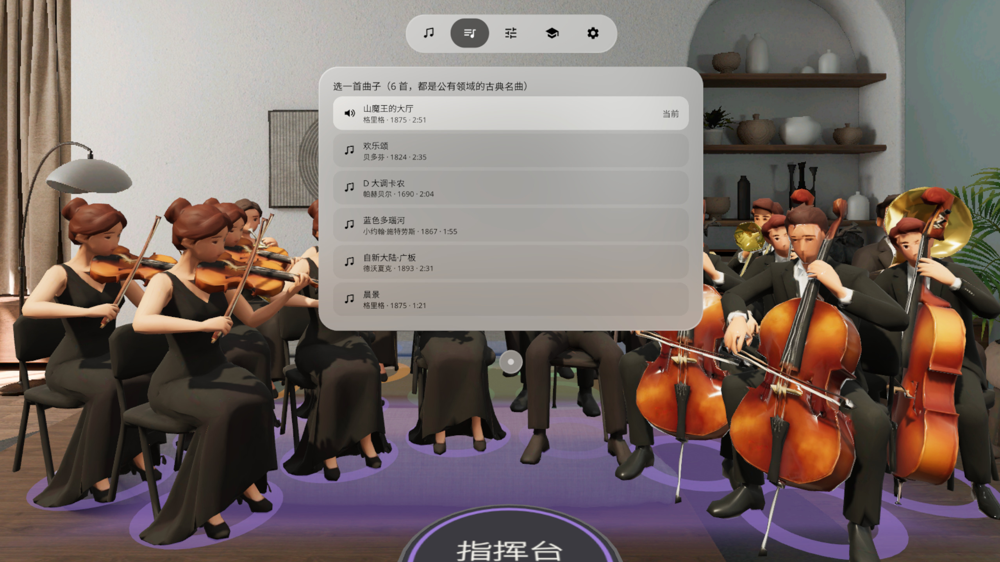
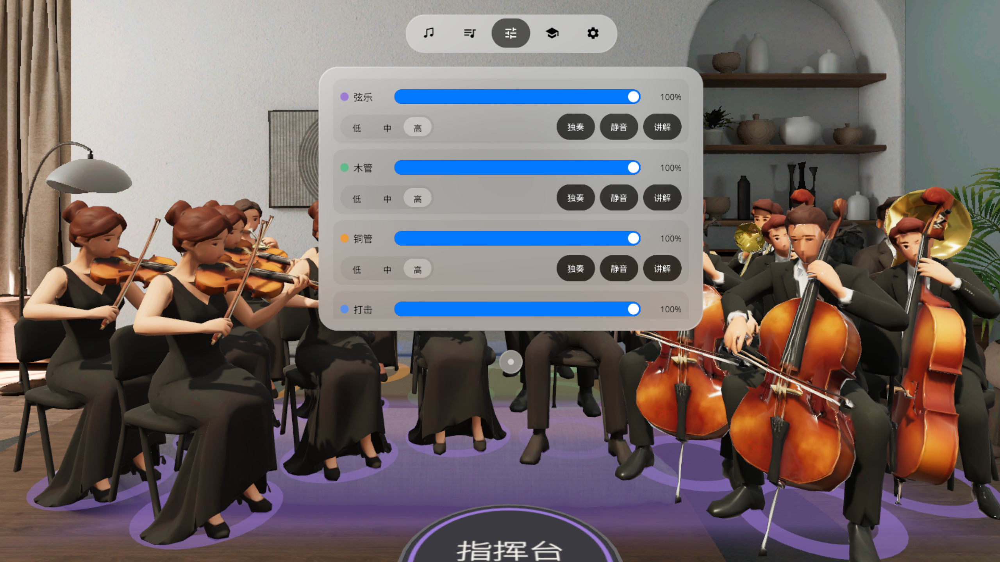
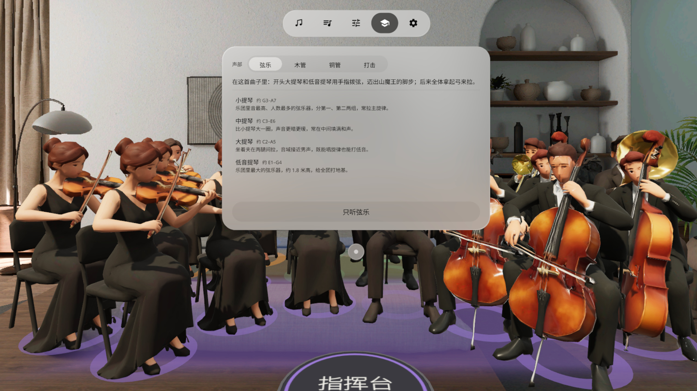
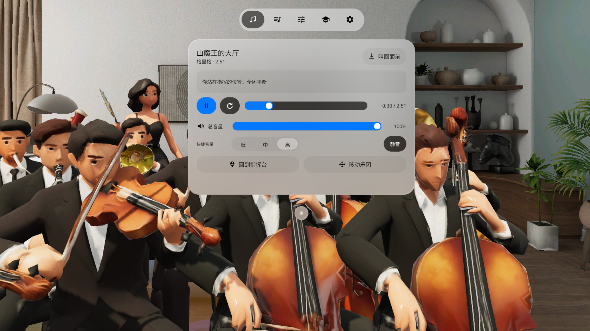

# Inside the Orchestra | 走进乐团



**交响乐团按真实座位坐满你的客厅，走到大提琴旁边就听清大提琴。**
*A symphony orchestra sits in your living room in its real seating plan. Walk up to the cellos and you hear the cellos.*

PICO OS 6 · Mixed Reality · Kotlin + PICO Spatial SDK 6.1.9 + SpatialUI · `io.embodit.insideorchestra` **v0.1.6**

## 中文

一支交响乐团按真实座位坐满你的客厅：弦乐在前、木管居中、铜管和打击乐在后。你站在指挥台上听全团，走到大提琴旁边就听清大提琴——每个声部都是单独的音轨，声音跟着你的位置变化。

- **六首古典名曲**：山魔王的大厅、欢乐颂、D 大调卡农、蓝色多瑙河、自新大陆·广板、晨景（均为公有领域），采样音色逐声部渲染
- **默认站在指挥台**：走近任何乐手听细节，「回到指挥台」一步回来
- **声部页**：弦乐 / 木管 / 铜管 / 打击乐各自调音量、独奏、静音、讲解；总音量滑条 + 低 / 中 / 高三档
- **学习页**：每种乐器在这首曲子里做什么，一键只听某个声部
- **一个原生窗口**：所有控制在一个系统窗口里，原生页签栏，系统控制条拖动，「叫回面前」
- 手势捏合 / 眼动注视 / 手柄射线；中英双语；离线运行，不联网、不需要账号

## English

A symphony orchestra fills your room in its real seating plan: strings in front, woodwinds in the middle, brass and percussion at the back. Stand on the podium to hear the whole orchestra, or walk up to any section to hear it up close — every section is its own stem and the balance follows where you stand.

- **Six classical pieces** (public domain): In the Hall of the Mountain King, Ode to Joy, Canon in D, The Blue Danube, New World Largo, Morning Mood — rendered per section with sampled instruments
- **Starts on the podium**; "Back to podium" returns you from anywhere
- **Sections page**: volume, solo, mute and notes for strings / woodwinds / brass / percussion; master slider plus Low / Mid / High presets
- **Learn page**: what each instrument does in this piece; solo one section with one tap
- **One native window** with the system TabBar, system drag bar and "Bring here"
- Pinch, eye gaze or controller ray; Chinese and English; fully offline, no account

## 截图 Screenshots

| | |
|---|---|
|  指挥台 · Podium |  走进弦乐声部 · Among the strings |
|  曲目 · Pieces |  声部 · Sections |
|  学习 · Learn |  大提琴旁 · Next to the cellos |

截图和 Release 里的演示视频都是模拟器录制、调试广播驱动，**非真实手势录像**。
*Screenshots and the demo video were captured on the PICO emulator, driven by debug broadcasts — **not real hand-gesture footage**.*

## 安装 Install

Release 附带的 `InsideTheOrchestra-v0.1.6.apk` 是**未签名的 release 包**（用于 Vibe Lab 上架签名），不能直接 `adb install`。自己装请先构建 debug 包：
*The APK attached to the Release is an **unsigned release build** (for store signing) and cannot be installed directly. To sideload, build a debug APK:*

```
./gradlew assembleDebug
adb install -r app/build/outputs/apk/debug/app-debug.apk
pico-cli app launch io.embodit.insideorchestra
```

## 许可 Credits

- 曲目均为公有领域作品；编配由本项目 `tools/repertoire.py` + `tools/make_music.py` 生成
- 音色：GeneralUser GS SoundFont（见 `app/src/main/assets/LICENSE-GeneralUser-GS.txt`、`assets/credits.txt`）
- 乐手模型：Tripo Studio 生成；字体 Noto Sans / Noto Sans SC（SIL OFL 1.1，见 `third_party/`）

开发说明见 [AGENTS.md](AGENTS.md)。
